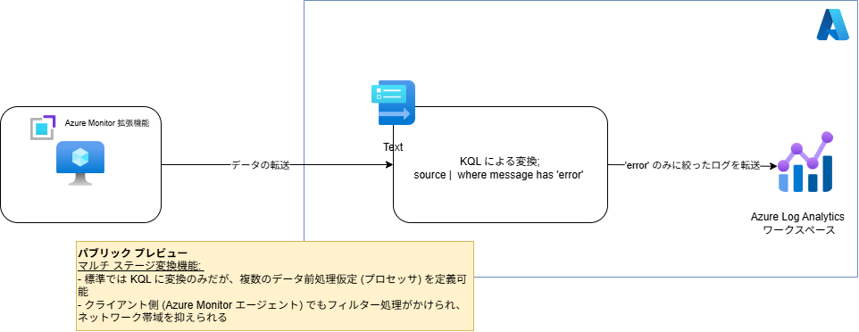
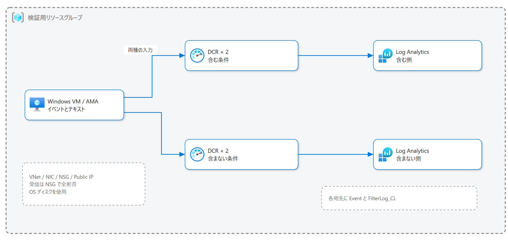
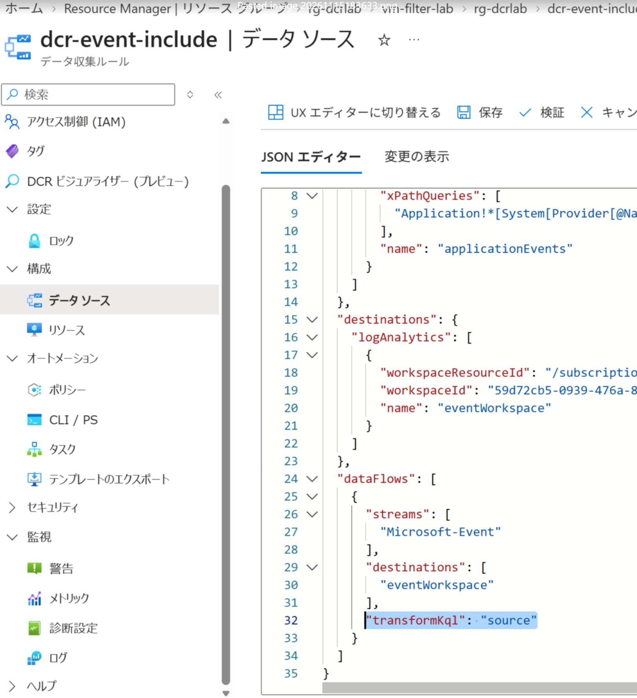
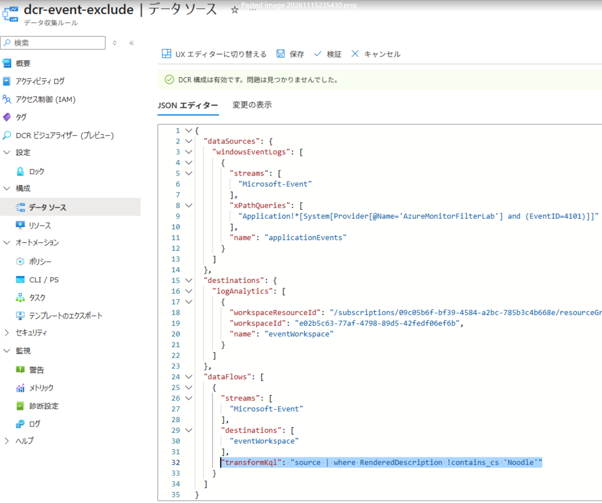
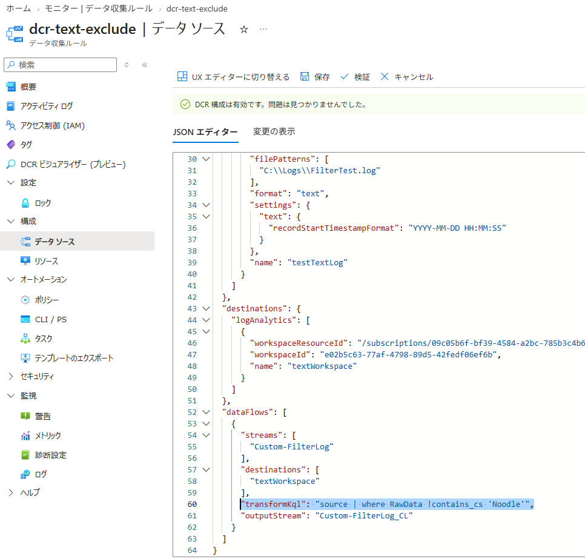
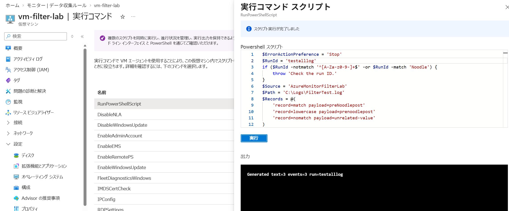
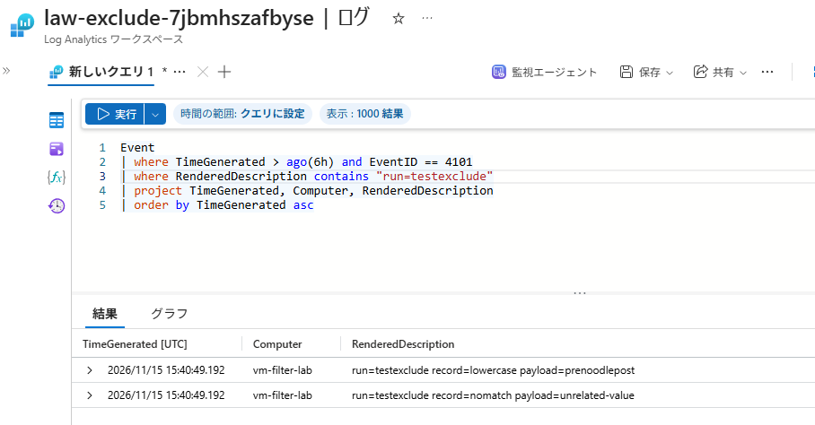
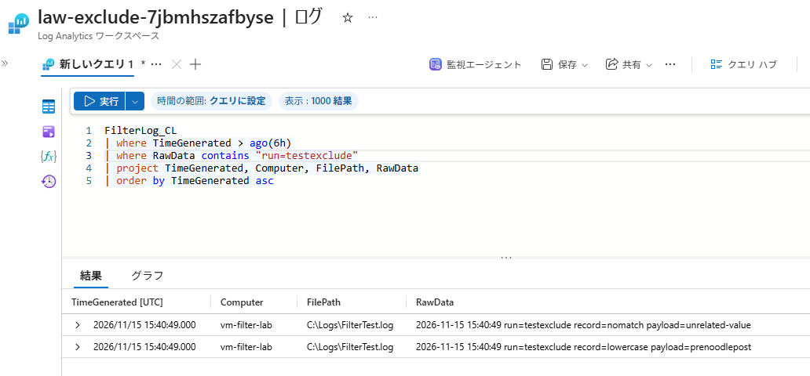

## モチベーション

Azure Monitor と言うと、Azure やオンプレミス、他クラウドからメトリック、ログを集約することができる Azure のソリューションです。昨今の状況だと、AI による運用　(AIOps) が様々な現場で検討され始め、そのとっかかりとしてメトリック、ログの集約を Azure Monitor に行おうというケースをよくうかがいます。
しかしながら、それらのデータを無作為に収集することによってアッという間にとんでもない金額に達することもあり、収集するデータの仕分けは必要です。

この記事では、 Azure Monitor の変換 (Transformations) 機能を使って、特定の文字列を含むログを除外してみます。

### Azure Monitor の変換機能とは？

Azure Monitor の変換機能は、収集したログデータに対してフィルタリングや加工を行うことができる機能です。例えば、収集されたログから特定の文字列のログのみを取り込むといったことが可能になります。標準の変換機能では、仮想マシンから Azure に送られ、Log Analytics ワークスペースに格納する前に、Kusto クエリ言語 (KQL)[^1] で選択されたログのみ格納するということができます。また、パブリック プレビューですが、クライアント側 (つまり、Azrue に送られる前) での変換をかけることができます[^2]。こうすることで、ログ転送によってネットワーク帯域の逼迫の軽減が期待できます。



なお、ログの収集に際してデータ収集ルール (Data Collection Rule, DCR) を使うのですが、イベントログの場合、DCR で XPath を使ったある程度のログのフィルタリングが可能で、これではできないのかという疑問が出るかもしれません。実は XPath を使う場合任意の文字列を含むものを取得するといったことが行えず、そうした場合には変換機能を使う必要があります。
(変換機能自体は DCR の一機能です
)。

## 検証環境

では、検証していきます。検証環境の構築については、後述で使った Azure Bicep テンプレートを掲載しています。



対象 VM は Windows Server 2022 Datacenter １台を用意して、合計４つの DCR を VM に関連付けています。
大きく分けて、Windows イベントログを収集するものと、特定のパスに置いたテキストファイルを収集するルールになります。さらにシナリオとして、変換機能により、特定の文字列を含むログを取り込むルールと、特定の文字列を含むログを取り込まないようにするルールに分けます。

| DCR 名 | 説明 |
|--|--|
| dcr-event-exclude | Windows イベントログのうち、特定の文字列を含むログを除外する |
| dcr-event-include | Windows イベントログのうち、特定の文字列を含むログのみを取り込む |
| dcr-text-exclude | 特定のパスに置いたテキストファイルのうち、特定の文字列を含むログを除外する |
| dcr-text-include | 特定のパスに置いたテキストファイルのうち、特定の文字列を含むログのみを取り込む |

ただ、Azure Bicep で環境を展開した時点では何も変換設定がされていない状態です。また、今回ログを含む方の DCR (dcr-*-include) は使いません。
この時、DCR のリソース定義を見ると変換機能の箇所は、`transformKql: source` となっています。これは何も変換しないという意味です。



## 検証

それでは、変換機能を試していきます。

### 特定の文字列を持つイベント ログを除外

例えば、Windows イベントログのうち、特定の文字列 ("Noodle") を含むログを除外してみます。

変更は、Azure ポータルからであっても、JSON を編集する方法を使ってください[^3]。というのも現時点の Azure ポータルでは、変換機能を使う場合に既存の Event テーブルへの変換後のデータの格納ができません。かならず、Log Analytics ワークスペースにカスタム テーブルを作成してそこへ可能しなくてはなりません。
他方、JSON を編集する方法ではそうならず、既存の Event テーブルへの変換後のデータの格納が可能です。

そうしましたら、 DCR で "データ ソース" → "コード エディタに切り替える" を選択し、`transformKql` 部分を以下の文言に変更します。

```yaml
source | where RenderedDescription !contains_cs 'Noodle'
```

上記の KQL は、RenderedDescription (イベントログの説明分) に 'Noodle' を含まないログのみを取り込むことを意味しています。mまた、`contains_cs` は、大文字と小文字を区別しますが、その必要がなければ `contains` を使います。



### 特定の文字列を持つカスタム ログを除外

同様にして、カスタム ログの内、特定の文字列を含む行を除外して Log Analytics へログを取り込みます。
Azure Bicep で展開している今回の DCR では、`C:\Logs\FilterTest.log` を対象にしています。

イベントログの場合は、`RawData` を使いフィルタリングします。

```yaml
source | where RawData !contains_cs 'Noodle'
```



### テストログを追加

今回の検証では、VM 自体にログインしてログを生成せず、VM の実行コマンド機能にてログを書き込みます。このあたりのスクリプトは AI に壁打ちして作成しています。
使い方として、`<試行ID>` の部分に後ほどログを検索するための識別子を指定して実行します。
ざっくりと、このスクリプトでは、３つのログ (Log Analytics ワークスペースへの取り込みを除外した文字列とぴったりのもの、小文字のもの、まったく異なるもの) を生成してます。また、イベントログとカスタム ログ双方のログが生成されます。

```powershell
$ErrorActionPreference = 'Stop'
$RunId = '<試行ID>'
if ($RunId -notmatch '^[A-Za-z0-9-]+$' -or $RunId -match 'Noodle') {
    throw 'Check the run ID.'
}
$Source = 'AzureMonitorFilterLab'
$Path = 'C:\Logs\FilterTest.log'
$Records = @(
    'record=match payload=preNoodlepost'
    'record=lowercase payload=prenoodlepost'
    'record=nomatch payload=unrelated-value'
)
if (-not [System.Diagnostics.EventLog]::SourceExists($Source)) {
    New-EventLog -LogName Application -Source $Source
}
if ([System.Diagnostics.EventLog]::LogNameFromSourceName($Source, '.') -ne 'Application') {
    throw 'The event source is not registered in Application.'
}
New-Item -Path 'C:\Logs' -ItemType Directory -Force | Out-Null
$Stream = $null
$Writer = $null
try {
    $Stream = [System.IO.File]::Open($Path, [System.IO.FileMode]::Append,
        [System.IO.FileAccess]::Write, [System.IO.FileShare]::ReadWrite)
    $Writer = [System.IO.StreamWriter]::new($Stream, [System.Text.UTF8Encoding]::new($false))
    foreach ($Record in $Records) {
        $Timestamp = (Get-Date).ToUniversalTime().ToString('yyyy-MM-dd HH:mm:ss')
        $Writer.WriteLine("$Timestamp run=$RunId $Record")
    }
    $Writer.Flush()
}
finally {
    if ($null -ne $Writer) { $Writer.Dispose() }
    elseif ($null -ne $Stream) { $Stream.Dispose() }
}
foreach ($Record in $Records) {
    Write-EventLog -LogName Application -Source $Source -EventId 4101 `
        -EntryType Information -Message "run=$RunId $Record"
}
"Generated text=3 events=3 run=$RunId"
```

以下は、上記スクリプトの実行例です。


### 検証結果の確認

上記で期待通り除外されているか見てみます。
Azure ポータルから Log Analytics ワークスペースを開き、"ログ" からクエリを実行して確認します。

#### イベントログの場合

```kusto
Event
| where TimeGenerated > ago(6h) and EventID == 4101
| where RenderedDescription contains "run=<同じ試行ID>"
| project TimeGenerated, Computer, RenderedDescription
| order by TimeGenerated asc
```

確認した結果、```payload=preNoodlepost``` を含むログは取り込まれていませんでした。一方、小文字の場合やまったく異なる場合のログは取り込まれています。期待通りの動作です。



次に、カスタム テキストログの取り込みについてみてみます。

```kusto
FilterLog_CL
| where TimeGenerated > ago(6h)
| where RawData contains "run=<同じ試行ID>"
| project TimeGenerated, Computer, FilePath, RawData
| order by TimeGenerated asc
```

こちらも期待通り、除外設定したログは取り込まれていません。



これと同じように特定の文字列を含むログのみを取り込むといった設定も可能です。このように監視設計がきっちりと固まっている場合には特定のログのみを Log Analytics に収集してコスト面で最適化を図ることができます。

また、日本語も UTF-8 の文字コードのものは取り込み、変換設定が可能です。一点注意点としては、変換機能についてデータ処理量に応じて課金が発生するケースがありますので、その点は事前に確認を行ってください [^4]。

## 付録: Azure Bicep テンプレート

::::details Azure Bicep テンプレートの詳細

* main.bicep

```bicep
targetScope = 'subscription'

param rgName string
param location string = 'australiaeast'
param expiresOnUtc string
@secure()
param adminPassword string

var tags = {
  SecurityControl: 'Ignore'
  ExpiresOn: expiresOnUtc
  Owner: 'azure-validation'
  Purpose: 'monitor-log-filter-validation'
}

resource rg 'Microsoft.Resources/resourceGroups@2024-03-01' = {
  name: rgName
  location: location
  tags: tags
}

module lab 'modules/lab.bicep' = {
  name: 'monitor-log-filter-lab'
  scope: rg
  params: {
    location: location
    tags: tags
    adminPassword: adminPassword
  }
}

output resourceGroupId string = rg.id
output vmName string = lab.outputs.vmName
output eventWorkspaceName string = lab.outputs.eventWorkspaceName
output eventWorkspaceId string = lab.outputs.eventWorkspaceId
output textWorkspaceName string = lab.outputs.textWorkspaceName
output textWorkspaceId string = lab.outputs.textWorkspaceId
output eventDcrNames array = lab.outputs.eventDcrNames
output textDcrNames array = lab.outputs.textDcrNames
```

* modules/lab.bicep

```bicep
param location string
param tags object
@secure()
param adminPassword string

var vmName = 'vm-filter-lab'
var eventWorkspaceName = 'law-include-${uniqueString(resourceGroup().id)}'
var textWorkspaceName = 'law-exclude-${uniqueString(resourceGroup().id)}'
var textStream = 'Custom-FilterLog'
var textOutputStream = 'Custom-FilterLog_CL'

resource eventWorkspace 'Microsoft.OperationalInsights/workspaces@2023-09-01' = {
  name: eventWorkspaceName
  location: location
  tags: tags
  properties: {
    sku: {
      name: 'PerGB2018'
    }
    retentionInDays: 30
    features: {
      enableLogAccessUsingOnlyResourcePermissions: true
    }
  }
}

resource textWorkspace 'Microsoft.OperationalInsights/workspaces@2023-09-01' = {
  name: textWorkspaceName
  location: location
  tags: tags
  properties: {
    sku: {
      name: 'PerGB2018'
    }
    retentionInDays: 30
    features: {
      enableLogAccessUsingOnlyResourcePermissions: true
    }
  }
}

resource textTable 'Microsoft.OperationalInsights/workspaces/tables@2022-10-01' = {
  parent: textWorkspace
  name: 'FilterLog_CL'
  properties: {
    schema: {
      name: 'FilterLog_CL'
      columns: [
        {
          name: 'TimeGenerated'
          type: 'datetime'
        }
        {
          name: 'Computer'
          type: 'string'
        }
        {
          name: 'FilePath'
          type: 'string'
        }
        {
          name: 'RawData'
          type: 'string'
        }
      ]
    }
  }
}

resource includeTextTable 'Microsoft.OperationalInsights/workspaces/tables@2022-10-01' = {
  parent: eventWorkspace
  name: 'FilterLog_CL'
  properties: {
    schema: {
      name: 'FilterLog_CL'
      columns: [
        {
          name: 'TimeGenerated'
          type: 'datetime'
        }
        {
          name: 'Computer'
          type: 'string'
        }
        {
          name: 'FilePath'
          type: 'string'
        }
        {
          name: 'RawData'
          type: 'string'
        }
      ]
    }
  }
}

resource vnet 'Microsoft.Network/virtualNetworks@2024-01-01' = {
  name: 'vnet-filter-lab'
  location: location
  tags: tags
  properties: {
    addressSpace: {
      addressPrefixes: [
        '10.30.0.0/24'
      ]
    }
    subnets: [
      {
        name: 'default'
        properties: {
          addressPrefix: '10.30.0.0/26'
        }
      }
    ]
  }
}

resource nsg 'Microsoft.Network/networkSecurityGroups@2024-01-01' = {
  name: 'nsg-filter-lab'
  location: location
  tags: tags
  properties: {
    securityRules: [
      {
        name: 'DenyAllInbound'
        properties: {
          priority: 100
          direction: 'Inbound'
          access: 'Deny'
          protocol: '*'
          sourcePortRange: '*'
          destinationPortRange: '*'
          sourceAddressPrefix: '*'
          destinationAddressPrefix: '*'
        }
      }
    ]
  }
}

resource publicIp 'Microsoft.Network/publicIPAddresses@2024-01-01' = {
  name: 'pip-filter-lab'
  location: location
  tags: tags
  sku: {
    name: 'Standard'
    tier: 'Regional'
  }
  properties: {
    publicIPAllocationMethod: 'Static'
    publicIPAddressVersion: 'IPv4'
  }
}

resource nic 'Microsoft.Network/networkInterfaces@2024-01-01' = {
  name: 'nic-filter-lab'
  location: location
  tags: tags
  properties: {
    networkSecurityGroup: {
      id: nsg.id
    }
    ipConfigurations: [
      {
        name: 'primary'
        properties: {
          subnet: {
            id: vnet.properties.subnets[0].id
          }
          privateIPAllocationMethod: 'Dynamic'
          publicIPAddress: {
            id: publicIp.id
          }
        }
      }
    ]
  }
}

resource vm 'Microsoft.Compute/virtualMachines@2024-03-01' = {
  name: vmName
  location: location
  tags: tags
  identity: {
    type: 'SystemAssigned'
  }
  properties: {
    hardwareProfile: {
      vmSize: 'Standard_B2s'
    }
    osProfile: {
      computerName: vmName
      adminUsername: 'labadmin'
      adminPassword: adminPassword
    }
    storageProfile: {
      imageReference: {
        publisher: 'MicrosoftWindowsServer'
        offer: 'WindowsServer'
        sku: '2022-datacenter'
        version: 'latest'
      }
      osDisk: {
        createOption: 'FromImage'
        managedDisk: {
          storageAccountType: 'StandardSSD_LRS'
        }
      }
    }
    networkProfile: {
      networkInterfaces: [
        {
          id: nic.id
        }
      ]
    }
    diagnosticsProfile: {
      bootDiagnostics: {
        enabled: false
      }
    }
  }
}

resource ama 'Microsoft.Compute/virtualMachines/extensions@2024-03-01' = {
  parent: vm
  name: 'AzureMonitorWindowsAgent'
  location: location
  tags: tags
  properties: {
    publisher: 'Microsoft.Azure.Monitor'
    type: 'AzureMonitorWindowsAgent'
    typeHandlerVersion: '1.0'
    autoUpgradeMinorVersion: true
    enableAutomaticUpgrade: true
  }
}

resource eventDcr 'Microsoft.Insights/dataCollectionRules@2023-03-11' = [for i in range(0, 2): {
  name: i == 0 ? 'dcr-event-include' : 'dcr-event-exclude'
  location: location
  tags: tags
  kind: 'Windows'
  properties: {
    dataSources: {
      windowsEventLogs: [
        {
          name: 'applicationEvents'
          streams: [
            'Microsoft-Event'
          ]
          xPathQueries: [
            'Application!*[System[Provider[@Name=\'AzureMonitorFilterLab\'] and (EventID=4101)]]'
          ]
        }
      ]
    }
    destinations: {
      logAnalytics: [
        {
          name: 'eventWorkspace'
          workspaceResourceId: i == 0 ? eventWorkspace.id : textWorkspace.id
        }
      ]
    }
    dataFlows: [
      {
        streams: [
          'Microsoft-Event'
        ]
        destinations: [
          'eventWorkspace'
        ]
        transformKql: 'source'
      }
    ]
  }
}]

resource textDcr 'Microsoft.Insights/dataCollectionRules@2023-03-11' = [for i in range(0, 2): {
  name: i == 0 ? 'dcr-text-include' : 'dcr-text-exclude'
  location: location
  tags: tags
  kind: 'Windows'
  properties: {
    dataSources: {
      logFiles: [
        {
          name: 'testTextLog'
          streams: [
            textStream
          ]
          filePatterns: [
            'C:\\Logs\\FilterTest.log'
          ]
          format: 'text'
          settings: {
            text: {
              recordStartTimestampFormat: 'YYYY-MM-DD HH:MM:SS'
            }
          }
        }
      ]
    }
    streamDeclarations: {
      '${textStream}': {
        columns: [
          {
            name: 'TimeGenerated'
            type: 'datetime'
          }
          {
            name: 'Computer'
            type: 'string'
          }
          {
            name: 'FilePath'
            type: 'string'
          }
          {
            name: 'RawData'
            type: 'string'
          }
        ]
      }
    }
    destinations: {
      logAnalytics: [
        {
          name: 'textWorkspace'
          workspaceResourceId: i == 0 ? eventWorkspace.id : textWorkspace.id
        }
      ]
    }
    dataFlows: [
      {
        streams: [
          textStream
        ]
        destinations: [
          'textWorkspace'
        ]
        outputStream: textOutputStream
        transformKql: 'source'
      }
    ]
  }
  dependsOn: [
    textTable
    includeTextTable
  ]
}]

resource eventAssociation 'Microsoft.Insights/dataCollectionRuleAssociations@2023-03-11' = [for i in range(0, 2): {
  name: i == 0 ? 'assoc-event-include' : 'assoc-event-exclude'
  scope: vm
  properties: {
    dataCollectionRuleId: eventDcr[i].id
  }
  dependsOn: [
    ama
  ]
}]

resource textAssociation 'Microsoft.Insights/dataCollectionRuleAssociations@2023-03-11' = [for i in range(0, 2): {
  name: i == 0 ? 'assoc-text-include' : 'assoc-text-exclude'
  scope: vm
  properties: {
    dataCollectionRuleId: textDcr[i].id
  }
  dependsOn: [
    ama
  ]
}]

output vmName string = vm.name
output eventWorkspaceName string = eventWorkspace.name
output eventWorkspaceId string = eventWorkspace.properties.customerId
output textWorkspaceName string = textWorkspace.name
output textWorkspaceId string = textWorkspace.properties.customerId
output eventDcrNames array = [for i in range(0, 2): eventDcr[i].name]
output textDcrNames array = [for i in range(0, 2): textDcr[i].name]
```
::::


[^1]: [Kusto Query Language (KQL) overview - Microsoft Learn](https://learn.microsoft.com/kusto/query/?view=azure-monitor)
[^2]: [複数ステージ変換 (プレビュー) - Microsoft Learn](https://learn.microsoft.com/ja-jp/azure/azure-monitor/data-collection/data-collection-transformations#multi-stage-transformations-preview)
[^3]: [JSON を使用してデータ収集規則 (DCR) を作成する方法 - Microsoft Learn](https://learn.microsoft.com/ja-jp/azure/azure-monitor/data-collection/data-collection-rule-create-edit?tabs=cli)
[^4]: [変換のコスト - Microsoft Learn](https://learn.microsoft.com/ja-jp/azure/azure-monitor/data-collection/data-collection-transformations#analytics-or-basic-logs)