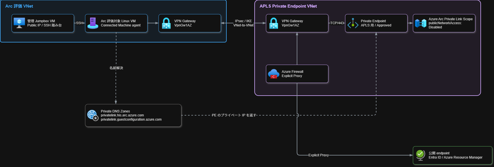

Azure Firewall Explicit Proxy は、2026年8月5日に一般提供 (GA) を迎えました [^1]。
この記事では、この機能を使って Azure Arc へのオンボーディングを行う方法について紹介します。

## Azure Firewall Explicit Proxy とは

Explicit (明示的な) とあるように、Azure Firewall Explicit Proxy は、クライアントが明示的にプロキシを指定して通信する方式です。
これまでは、Azure Firewall を通してインターネットへのエグレス通信を行う場合、Azure Firewall に対して強制的にトラフィックを送るようにルーティングする必要がありました。
そのため、明示的なプロキシが必要な場合、例えば squid を仮想マシンに構築し、そこを指定するという方法でした。
しかし、この機能によってユーザー側で管理・運用する必要がない、明示的なプロキシサーバーが利用可能になりました。
また、Azure Firewall 本来の機能と同様、L7 での通信制御が可能です。

## Azure Arc でのユースケース

Azure Arc は、オンプレミス環境や他クラウド環境にあるサーバーを Azure 上のリソースとして管理するためのサービスです。
利用に際して Azure のパブリックエンドポイントを含む、複数のネットワーク アウトバウンド要件があります [^2]。

一般的に、オンプレミス環境からエグレス方向の通信であっても、許可を得るのは容易ではありません。
そこで、いくつかの通信要件に対しては、プライベートに閉じた通信とする方式を取ることが可能です。
それでもプライベート化できない通信要件が残るため、そうした通信は Azure Firewall Explicit Proxy へトラフィックを送り、
そこからパブリックエンドポイントへ到達させるという構成を取ることが可能です。

本記事ではこの構成を検証します。

## 検証環境構築

今回片方の VNet をオンプレミスと見立てて、VNet 間を VPN 接続する構成を取ります。
また、通常の Azure VM を Azure Arc 化するにあたり、プラットフォームから Azure VM と判断するための通信を塞ぎ、
オンプレミスのマシンと見立てています。



環境構築の大半は Azure Bicep で構築します。

```
apls-arc/
└── infra/
    ├── main.bicep          サブスクリプションスコープの入口
    ├── main.bicepparam     パラメーター定義
    └── modules/
        ├── networking.bicep
        ├── arc-private-link.bicep
        ├── compute.bicep
        └── firewall.bicep
```

:::details Azure Bicep テンプレート詳細

:::message
この Azure Bicep テンプレートによって課金対象のリソースが作成されます。
また、利用に際して発生する不都合、障害は責任を負いかねますので、ご了承ください。
:::

VNet や VNet 間 VPN 接続を構築

```bicep
// modules/networking.bicep

@description('Deployment region.')
param location string

@description('Common resource tags.')
param tags object

@description('Shared key for the VNet-to-VNet VPN connection.')
@secure()
param vpnSharedKey string

@description('Public IPv4 CIDR allowed to SSH to the administrative Jumpbox.')
param adminSourceAddressPrefix string

var arcEvaluationVnetName = 'vnet-arc-evaluation'
var aplsVnetName = 'vnet-apls-private-endpoint'
var arcEvaluationGatewaySubnetId = resourceId('Microsoft.Network/virtualNetworks/subnets', arcEvaluationVnetName, 'GatewaySubnet')
var aplsGatewaySubnetId = resourceId('Microsoft.Network/virtualNetworks/subnets', aplsVnetName, 'GatewaySubnet')


// Create NSG for the Arc evaluation VM.
resource arcEvaluationVmNsg 'Microsoft.Network/networkSecurityGroups@2024-07-01' = {
  name: 'nsg-arc-evaluation'
  location: location
  tags: tags
  properties: {
    securityRules: [
      {
        name: 'AllowAdminJumpboxSshInbound'
        properties: {
          priority: 120
          direction: 'Inbound'
          access: 'Allow'
          protocol: 'Tcp'
          sourceAddressPrefix: '10.50.2.0/24'
          sourcePortRange: '*'
          destinationAddressPrefix: '10.50.1.0/24'
          destinationPortRange: '22'
        }
      }
      {
        name: 'AllowVirtualNetworkOutbound'
        properties: {
          priority: 100
          direction: 'Outbound'
          access: 'Allow'
          protocol: '*'
          sourceAddressPrefix: 'VirtualNetwork'
          sourcePortRange: '*'
          destinationAddressPrefix: 'VirtualNetwork'
          destinationPortRange: '*'
        }
      }
      {
        name: 'DenyInternetOutbound'
        properties: {
          priority: 4000
          direction: 'Outbound'
          access: 'Deny'
          protocol: '*'
          sourceAddressPrefix: '*'
          sourcePortRange: '*'
          destinationAddressPrefix: 'Internet'
          destinationPortRange: '*'
        }
      }
    ]
  }
}

// Create NSG for Admin Jumpbox VM
resource adminJumpboxNsg 'Microsoft.Network/networkSecurityGroups@2024-07-01' = {
  name: 'nsg-arc-admin-jumpbox'
  location: location
  tags: tags
  properties: {
    securityRules: [
      {
        name: 'AllowSshFromAdmin'
        properties: {
          priority: 100
          direction: 'Inbound'
          access: 'Allow'
          protocol: 'Tcp'
          sourceAddressPrefix: adminSourceAddressPrefix
          sourcePortRange: '*'
          destinationAddressPrefix: '10.50.2.0/24'
          destinationPortRange: '22'
        }
      }
    ]
  }
}

// Create VNet for the Arc evaluation VM and administrative Jumpbox.
resource arcEvaluationVnet 'Microsoft.Network/virtualNetworks@2024-07-01' = {
  name: arcEvaluationVnetName
  location: location
  tags: tags
  properties: {
    addressSpace: {
      addressPrefixes: [
        '10.50.0.0/16'
      ]
    }
    subnets: [
      {
        name: 'ArcEvaluationSubnet'
        properties: {
          addressPrefix: '10.50.1.0/24'
          networkSecurityGroup: {
            id: arcEvaluationVmNsg.id
          }
        }
      }
      {
        name: 'GatewaySubnet'
        properties: {
          addressPrefix: '10.50.255.0/27'
        }
      }
      {
        name: 'AdminJumpboxSubnet'
        properties: {
          addressPrefix: '10.50.2.0/24'
          networkSecurityGroup: {
            id: adminJumpboxNsg.id
          }
        }
      }
    ]
  }
}

// Create VNet for APLS Private Endpoint
resource aplsVnet 'Microsoft.Network/virtualNetworks@2024-07-01' = {
  name: aplsVnetName
  location: location
  tags: tags
  properties: {
    addressSpace: {
      addressPrefixes: [
        '10.60.0.0/16'
      ]
    }
    subnets: [
      {
        name: 'PrivateEndpointSubnet'
        properties: {
          addressPrefix: '10.60.1.0/24'
          privateEndpointNetworkPolicies: 'Disabled'
        }
      }
      {
        name: 'AzureFirewallSubnet'
        properties: {
          addressPrefix: '10.60.2.0/26'
        }
      }
      {
        name: 'GatewaySubnet'
        properties: {
          addressPrefix: '10.60.255.0/27'
        }
      }
    ]
  }
}

// Create public IP addresses for the VPN gateways
resource arcPip 'Microsoft.Network/publicIPAddresses@2024-07-01' = {
  name: 'pip-vpng-arc-zonal'
  location: location
  tags: tags
  sku: {
    name: 'Standard'
  }
  zones: [
    '1'
    '2'
    '3'
  ]
  properties: {
    publicIPAllocationMethod: 'Static'
    publicIPAddressVersion: 'IPv4'
  }
}

// Create public IP addresses for the VPN gateways
resource aplsPip 'Microsoft.Network/publicIPAddresses@2024-07-01' = {
  name: 'pip-vpng-apls-zonal'
  location: location
  tags: tags
  sku: {
    name: 'Standard'
  }
  zones: [
    '1'
    '2'
    '3'
  ]
  properties: {
    publicIPAllocationMethod: 'Static'
    publicIPAddressVersion: 'IPv4'
  }
}

// Create VPN gateway for the Arc evaluation VNet.
resource arcEvaluationGateway 'Microsoft.Network/virtualNetworkGateways@2024-07-01' = {
  name: 'vpng-arc-evaluation'
  location: location
  tags: tags
  properties: {
    activeActive: false
    enableBgp: false
    gatewayType: 'Vpn'
    vpnType: 'RouteBased'
    sku: {
      name: 'VpnGw1AZ'
      tier: 'VpnGw1AZ'
    }
    ipConfigurations: [
      {
        name: 'gatewayConfig'
        properties: {
          privateIPAllocationMethod: 'Dynamic'
          subnet: {
            id: arcEvaluationGatewaySubnetId
          }
          publicIPAddress: {
            id: arcPip.id
          }
        }
      }
    ]
  }
}

// Create VPN gateways for the APLS Private Endpoint VNet
resource aplsGateway 'Microsoft.Network/virtualNetworkGateways@2024-07-01' = {
  name: 'vpng-apls'
  location: location
  tags: tags
  properties: {
    activeActive: false
    enableBgp: false
    gatewayType: 'Vpn'
    vpnType: 'RouteBased'
    sku: {
      name: 'VpnGw1AZ'
      tier: 'VpnGw1AZ'
    }
    ipConfigurations: [
      {
        name: 'gatewayConfig'
        properties: {
          privateIPAllocationMethod: 'Dynamic'
          subnet: {
            id: aplsGatewaySubnetId
          }
          publicIPAddress: {
            id: aplsPip.id
          }
        }
      }
    ]
  }
}

// Create connections between the VPN gateways
resource arcToAplsConnection 'Microsoft.Network/connections@2024-07-01' = {
  name: 'conn-arc-apls-vnet'
  location: location
  tags: tags
  properties: {
    connectionType: 'Vnet2Vnet'
    enableBgp: false
    sharedKey: vpnSharedKey
    virtualNetworkGateway1: {
      id: arcEvaluationGateway.id
      properties: {}
    }
    virtualNetworkGateway2: {
      id: aplsGateway.id
      properties: {}
    }
  }
}

// Create connections between the VPN gateways
resource aplsToArcConnection 'Microsoft.Network/connections@2024-07-01' = {
  name: 'conn-apls-arc-vnet'
  location: location
  tags: tags
  properties: {
    connectionType: 'Vnet2Vnet'
    enableBgp: false
    sharedKey: vpnSharedKey
    virtualNetworkGateway1: {
      id: aplsGateway.id
      properties: {}
    }
    virtualNetworkGateway2: {
      id: arcEvaluationGateway.id
      properties: {}
    }
  }
}

// Outputs
output arcEvaluationVnetId string = arcEvaluationVnet.id
output aplsVnetId string = aplsVnet.id
output arcEvaluationSubnetId string = resourceId('Microsoft.Network/virtualNetworks/subnets', arcEvaluationVnet.name, 'ArcEvaluationSubnet')
output adminSubnetId string = resourceId('Microsoft.Network/virtualNetworks/subnets', arcEvaluationVnet.name, 'AdminJumpboxSubnet')
output privateEndpointSubnetId string = resourceId('Microsoft.Network/virtualNetworks/subnets', aplsVnet.name, 'PrivateEndpointSubnet')
```

Azure Arc Private Link Service (APLS) や、プライベート DNS ゾーンを構築

```bicep
// modules/arc-private-link.bicep

@description('Deployment region.')
param location string

@description('Common resource tags.')
param tags object

@description('Resource ID of the Arc evaluation VNet.')
param arcEvaluationVnetId string

@description('Resource ID of the APLS VNet.')
param aplsVnetId string

@description('Resource ID of the subnet hosting the APLS private endpoint.')
param privateEndpointSubnetId string

var hisZoneName = 'privatelink.his.arc.azure.com'
var guestConfigurationZoneName = 'privatelink.guestconfiguration.azure.com'

// Private Link Scope for Azure Arc
resource privateLinkScope 'Microsoft.HybridCompute/privateLinkScopes@2025-01-13' = {
  name: 'apls-arc-private-scope'
  location: location
  properties: {
    publicNetworkAccess: 'Disabled'
  }
  tags: tags
}

// Private Endpoint for Azure Arc PLS
resource privateEndpoint 'Microsoft.Network/privateEndpoints@2024-07-01' = {
  name: 'pep-apls-arc'
  location: location
  properties: {
    subnet: {
      id: privateEndpointSubnetId
    }
    privateLinkServiceConnections: [
      {
        name: 'apls-arc-connection'
        properties: {
          privateLinkServiceId: privateLinkScope.id
          groupIds: [
            'hybridcompute'
          ]
        }
      }
    ]
  }
  tags: tags
}

// Private DNS Zones for HIS
resource hisZone 'Microsoft.Network/privateDnsZones@2024-06-01' = {
  name: hisZoneName
  location: 'global'
  tags: tags
  properties: {}
}

// Private DNS Zones for Guest Configuration
resource guestConfigurationZone 'Microsoft.Network/privateDnsZones@2024-06-01' = {
  name: guestConfigurationZoneName
  location: 'global'
  tags: tags
  properties: {}
}

// Links between Private DNS Zones and VNets (HIS)
resource hisZoneArcLink 'Microsoft.Network/privateDnsZones/virtualNetworkLinks@2024-06-01' = {
  parent: hisZone
  name: 'arc-evaluation-vnet-link'
  location: 'global'
  tags: tags
  properties: {
    registrationEnabled: false
    virtualNetwork: {
      id: arcEvaluationVnetId
    }
  }
}

// Links between Private DNS Zones and VNets (HIS)
resource hisZoneAplsLink 'Microsoft.Network/privateDnsZones/virtualNetworkLinks@2024-06-01' = {
  parent: hisZone
  name: 'apls-vnet-link'
  location: 'global'
  tags: tags
  properties: {
    registrationEnabled: false
    virtualNetwork: {
      id: aplsVnetId
    }
  }
}

// Links between Private DNS Zones and VNets (Guest Configuration)
resource guestZoneArcLink 'Microsoft.Network/privateDnsZones/virtualNetworkLinks@2024-06-01' = {
  parent: guestConfigurationZone
  name: 'arc-evaluation-vnet-link'
  location: 'global'
  tags: tags
  properties: {
    registrationEnabled: false
    virtualNetwork: {
      id: arcEvaluationVnetId
    }
  }
}

// Links between Private DNS Zones and VNets (Guest Configuration)
resource guestZoneAplsLink 'Microsoft.Network/privateDnsZones/virtualNetworkLinks@2024-06-01' = {
  parent: guestConfigurationZone
  name: 'apls-vnet-link'
  location: 'global'
  tags: tags
  properties: {
    registrationEnabled: false
    virtualNetwork: {
      id: aplsVnetId
    }
  }
}


// Private DNS Zone Group for the Private Endpoint
resource dnsZoneGroup 'Microsoft.Network/privateEndpoints/privateDnsZoneGroups@2024-07-01' = {
  parent: privateEndpoint
  name: 'arc-dns-zone-group'
  properties: {
    privateDnsZoneConfigs: [
      {
        name: 'his-arc-zone'
        properties: {
          privateDnsZoneId: hisZone.id
        }
      }
      {
        name: 'guest-configuration-zone'
        properties: {
          privateDnsZoneId: guestConfigurationZone.id
        }
      }
    ]
  }
}

// Outputs
output privateEndpointId string = privateEndpoint.id
output privateLinkScopeId string = privateLinkScope.id
```

Azure Arc 評価用 VM と管理用踏み台サーバー VM の構築

```bicep
@description('Deployment region.')
param location string

@description('Common resource tags.')
param tags object

@description('Resource ID of the Arc evaluation VM subnet.')
param arcEvaluationSubnetId string

@description('Resource ID of the administrative Jumpbox subnet.')
param adminSubnetId string

@description('Linux administrator name.')
param adminUsername string

@description('SSH public key.')
@secure()
param sshPublicKey string

// NIC for the Arc evaluation VM
resource arcEvaluationVmNic 'Microsoft.Network/networkInterfaces@2024-07-01' = {
  name: 'nic-arc-evaluation'
  location: location
  properties: {
    ipConfigurations: [
      {
        name: 'ipconfig1'
        properties: {
          privateIPAllocationMethod: 'Dynamic'
          subnet: {
            id: arcEvaluationSubnetId
          }
        }
      }
    ]
  }
  tags: tags
}

// Public IP for the administrative Jumpbox
resource adminJumpboxPip 'Microsoft.Network/publicIPAddresses@2024-07-01' = {
  name: 'pip-arc-admin-jumpbox'
  location: location
  sku: {
    name: 'Standard'
  }
  properties: {
    publicIPAllocationMethod: 'Static'
    publicIPAddressVersion: 'IPv4'
  }
  tags: tags
}

// NIC for the administrative Jumpbox
resource adminJumpboxNic 'Microsoft.Network/networkInterfaces@2024-07-01' = {
  name: 'nic-arc-admin-jumpbox'
  location: location
  properties: {
    ipConfigurations: [
      {
        name: 'ipconfig1'
        properties: {
          privateIPAllocationMethod: 'Dynamic'
          subnet: {
            id: adminSubnetId
          }
          publicIPAddress: {
            id: adminJumpboxPip.id
          }
        }
      }
    ]
  }
  tags: tags
}

// Deploy the Arc evaluation VM
resource arcEvaluationVm 'Microsoft.Compute/virtualMachines@2024-11-01' = {
  name: 'vm-arc-evaluation'
  location: location
  identity: {
    type: 'SystemAssigned'
  }
  tags: union(tags, { role: 'azure-arc-evaluation-vm' })
  properties: {
    hardwareProfile: {
      vmSize: 'Standard_B2s'
    }
    securityProfile: {
      securityType: 'TrustedLaunch'
      uefiSettings: {
        secureBootEnabled: true
        vTpmEnabled: true
      }
    }
    osProfile: {
      computerName: 'arc-evaluation'
      adminUsername: adminUsername
      linuxConfiguration: {
        disablePasswordAuthentication: true
        ssh: {
          publicKeys: [
            {
              path: '/home/${adminUsername}/.ssh/authorized_keys'
              keyData: sshPublicKey
            }
          ]
        }
      }
    }
    storageProfile: {
      imageReference: {
        publisher: 'Canonical'
        offer: '0001-com-ubuntu-server-jammy'
        sku: '22_04-lts-gen2'
        version: 'latest'
      }
      osDisk: {
        createOption: 'FromImage'
        managedDisk: {
          storageAccountType: 'StandardSSD_LRS'
        }
      }
    }
    networkProfile: {
      networkInterfaces: [
        {
          id: arcEvaluationVmNic.id
          properties: {
            primary: true
          }
        }
      ]
    }
    diagnosticsProfile: {
      bootDiagnostics: {
        enabled: true
      }
    }
  }
}

// Deploy the administrative Jumpbox VM
resource adminJumpbox 'Microsoft.Compute/virtualMachines@2024-11-01' = {
  name: 'vm-arc-admin-jumpbox'
  location: location
  tags: union(tags, { role: 'administrative-jumpbox' })
  properties: {
    hardwareProfile: {
      vmSize: 'Standard_B2s'
    }
    securityProfile: {
      securityType: 'TrustedLaunch'
      uefiSettings: {
        secureBootEnabled: true
        vTpmEnabled: true
      }
    }
    osProfile: {
      computerName: 'arc-admin-jumpbox'
      adminUsername: adminUsername
      linuxConfiguration: {
        disablePasswordAuthentication: true
        ssh: {
          publicKeys: [
            {
              path: '/home/${adminUsername}/.ssh/authorized_keys'
              keyData: sshPublicKey
            }
          ]
        }
      }
    }
    storageProfile: {
      imageReference: {
        publisher: 'Canonical'
        offer: '0001-com-ubuntu-server-jammy'
        sku: '22_04-lts-gen2'
        version: 'latest'
      }
      osDisk: {
        createOption: 'FromImage'
        managedDisk: {
          storageAccountType: 'StandardSSD_LRS'
        }
      }
    }
    networkProfile: {
      networkInterfaces: [
        {
          id: adminJumpboxNic.id
          properties: {
            primary: true
          }
        }
      ]
    }
    diagnosticsProfile: {
      bootDiagnostics: {
        enabled: true
      }
    }
  }
}

// Outputs
output arcEvaluationVmId string = arcEvaluationVm.id
output adminJumpboxId string = adminJumpbox.id
output adminJumpboxPublicIp string = adminJumpboxPip.properties.ipAddress
```

Azure Firewall のデプロイと Azure Firewall Explicit Proxy の設定

```bicep
param location string

@description('Common resource tags.')
param tags object

@description('Source CIDR allowed to use the explicit proxy. The Arc evaluation subnet.')
param proxyClientAddressPrefix string = '10.50.1.0/24'

@description('Extra FQDNs reachable through the explicit proxy, in addition to the Entra ID and Resource Manager hosts derived from the cloud environment.')
param additionalAllowedFqdns array = [
  '*.microsoftonline.com'
  '*.microsoftonline-p.com'
  'login.windows.net'
  'pas.windows.net'
]

var loginHost = replace(replace(environment().authentication.loginEndpoint, 'https://', ''), '/', '')
var resourceManagerHost = replace(replace(environment().resourceManager, 'https://', ''), '/', '')
var allowedFqdns = union([loginHost], additionalAllowedFqdns, [resourceManagerHost])

var aplsVnetName = 'vnet-apls-private-endpoint'
var firewallSubnetId = resourceId('Microsoft.Network/virtualNetworks/subnets', aplsVnetName, 'AzureFirewallSubnet')

// Log Analytics workspace for Azure Firewall diagnostics
resource logAnalytics 'Microsoft.OperationalInsights/workspaces@2023-09-01' = {
  name: 'law-apls-arc'
  location: location
  tags: tags
  properties: {
    sku: {
      name: 'PerGB2018'
    }
    retentionInDays: 30
    features: {
      enableLogAccessUsingOnlyResourcePermissions: true
    }
  }
}

// Firewall public IP
resource firewallPip 'Microsoft.Network/publicIPAddresses@2024-07-01' = {
  name: 'pip-afw-apls-arc'
  location: location
  sku: {
    name: 'Standard'
    tier: 'Regional'
  }
  tags: tags
  properties: {
    publicIPAllocationMethod: 'Static'
    publicIPAddressVersion: 'IPv4'
  }
}

// Firewall policy for Azure Firewall
resource firewallPolicy 'Microsoft.Network/firewallPolicies@2024-07-01' = {
  name: 'afwp-apls-arc'
  location: location
  tags: tags
  properties: {
    sku: {
      tier: 'Standard'
    }
    threatIntelMode: 'Alert'
    explicitProxy: {
      enableExplicitProxy: true
      httpPort: 8080
      httpsPort: 8443
    }
  }
}

// RCG for allowing outbound traffic to Entra ID and Resource Manager hosts, as well as additional allowed FQDNs
resource ruleCollectionGroup 'Microsoft.Network/firewallPolicies/ruleCollectionGroups@2024-07-01' = {
  parent: firewallPolicy
  name: 'rcg-arc-public-endpoints'
  properties: {
    priority: 200
    ruleCollections: [
      {
        ruleCollectionType: 'FirewallPolicyFilterRuleCollection'
        name: 'arc-public-allow'
        priority: 200
        action: {
          type: 'Allow'
        }
        rules: [
          {
            ruleType: 'ApplicationRule'
            name: 'allow-entra-arm'
            sourceAddresses: [
              proxyClientAddressPrefix
            ]
            protocols: [
              {
                protocolType: 'Http'
                port: 80
              }
              {
                protocolType: 'Https'
                port: 443
              }
            ]
            targetFqdns: allowedFqdns
          }
        ]
      }
    ]
  }
}

// Deploy the Azure Firewall
resource firewall 'Microsoft.Network/azureFirewalls@2024-07-01' = {
  name: 'afw-apls-arc'
  location: location
  tags: tags
  properties: {
    sku: {
      name: 'AZFW_VNet'
      tier: 'Standard'
    }
    threatIntelMode: 'Alert'
    firewallPolicy: {
      id: firewallPolicy.id
    }
    ipConfigurations: [
      {
        name: 'ipconfig1'
        properties: {
          subnet: {
            id: firewallSubnetId
          }
          publicIPAddress: {
            id: firewallPip.id
          }
        }
      }
    ]
  }
  dependsOn: [
    ruleCollectionGroup
  ]
}

// Configure diagnostic settings for the Azure Firewall to send logs and metrics to the Log Analytics workspace
resource firewallDiagnostics 'Microsoft.Insights/diagnosticSettings@2021-05-01-preview' = {
  scope: firewall
  name: 'diag-afw-apls-arc'
  properties: {
    workspaceId: logAnalytics.id
    logAnalyticsDestinationType: 'Dedicated'
    logs: [
      {
        category: 'AZFWApplicationRule'
        enabled: true
      }
      {
        category: 'AZFWNetworkRule'
        enabled: true
      }
      {
        category: 'AZFWDnsQuery'
        enabled: true
      }
      {
        category: 'AZFWFqdnResolveFailure'
        enabled: true
      }
    ]
    metrics: [
      {
        category: 'AllMetrics'
        enabled: true
      }
    ]
  }
}

// Outputs
output firewallId string = firewall.id
output firewallPrivateIp string = firewall.properties.ipConfigurations[0].properties.privateIPAddress
output explicitProxyUrl string = 'http://${firewall.properties.ipConfigurations[0].properties.privateIPAddress}:8080'
output logAnalyticsWorkspaceId string = logAnalytics.id
output logAnalyticsCustomerId string = logAnalytics.properties.customerId
```

最後に main.bicep で各モジュールを呼び出して、リソースグループを作成し、各モジュールを実行します。

```bicep
targetScope = 'subscription'

@description('Azure region for all regional resources.')
param location string = '<リージョン>'

@description('Resource group for the disposable verification environment.')
param resourceGroupName string = 'rg-arc-plslab'

@description('Linux administrator name for the Arc evaluation VM and administrative Jumpbox.')
param adminUsername string

@description('SSH public key for the Arc evaluation VM and administrative Jumpbox.')
@secure()
param sshPublicKey string

@description('Shared key for the VNet-to-VNet VPN connection.')
@secure()
param vpnSharedKey string

@description('Public IPv4 CIDR allowed to SSH to the administrative Jumpbox.')
param adminSourceAddressPrefix string

var commonTags = {
  environment: 'test'
}

// Create resource group
resource rg 'Microsoft.Resources/resourceGroups@2025-04-01' = {
  name: resourceGroupName
  location: location
  tags: commonTags
}

module networking './modules/networking.bicep' = {
  name: 'networking'
  scope: rg
  params: {
    location: location
    tags: commonTags
    vpnSharedKey: vpnSharedKey
    adminSourceAddressPrefix: adminSourceAddressPrefix
  }
}

// Create networking stack
module arcPrivateLink './modules/arc-private-link.bicep' = {
  name: 'arc-private-link'
  scope: rg
  params: {
    location: location
    tags: commonTags
    arcEvaluationVnetId: networking.outputs.arcEvaluationVnetId
    aplsVnetId: networking.outputs.aplsVnetId
    privateEndpointSubnetId: networking.outputs.privateEndpointSubnetId
  }
}

// Create compute stack
module compute './modules/compute.bicep' = {
  name: 'compute'
  scope: rg
  params: {
    location: location
    tags: commonTags
    arcEvaluationSubnetId: networking.outputs.arcEvaluationSubnetId
    adminSubnetId: networking.outputs.adminSubnetId
    adminUsername: adminUsername
    sshPublicKey: sshPublicKey
  }
}

// Create firewall stack
module firewall './modules/firewall.bicep' = {
  name: 'firewall'
  scope: rg
  params: {
    location: location
    tags: commonTags
  }
  dependsOn: [
    networking
  ]
}

// Output
output resourceGroupId string = rg.id
output arcEvaluationVmId string = compute.outputs.arcEvaluationVmId
output adminJumpboxId string = compute.outputs.adminJumpboxId
output adminJumpboxPublicIp string = compute.outputs.adminJumpboxPublicIp
output arcEvaluationVnetId string = networking.outputs.arcEvaluationVnetId
output aplsVnetId string = networking.outputs.aplsVnetId
output privateEndpointId string = arcPrivateLink.outputs.privateEndpointId
output explicitProxyUrl string = firewall.outputs.explicitProxyUrl
output logAnalyticsWorkspaceId string = firewall.outputs.logAnalyticsWorkspaceId
output logAnalyticsCustomerId string = firewall.outputs.logAnalyticsCustomerId
```

main.bicep から参照するパラメータ定義ファイルはこちら。
リージョン、リソースグループ名以外は、この後に設定する環境変数の値を参照するようにしています。

```bicep
using './main.bicep'

param location = '<リージョン>'
param resourceGroupName = 'rg-arcpslab'
param adminUsername = readEnvironmentVariable('ARC_EVALUATION_VM_ADMIN_USERNAME')
param sshPublicKey = readEnvironmentVariable('ARC_EVALUATION_VM_SSH_PUBLIC_KEY')
param vpnSharedKey = readEnvironmentVariable('ARC_VPN_SHARED_KEY')
param adminSourceAddressPrefix = readEnvironmentVariable('ARC_ADMIN_SOURCE_ADDRESS_PREFIX')
```

:::

テンプレートの検証を実行し、次いでデプロイしましょう。

```bash
# パラメータの設定
export ARC_EVALUATION_VM_ADMIN_USERNAME="azureuser"
export ARC_EVALUATION_VM_SSH_PUBLIC_KEY="$(cat ~/.ssh/id_rsa.pub)"
export ARC_VPN_SHARED_KEY="YourStrongSharedKey123!"
export ARC_ADMIN_SOURCE_ADDRESS_PREFIX="$(curl -fsSL http://ifconfig.me/ip 2>/dev/null | tr -d '\r\n')/32"

# what-if でテンプレート起因のエラーがないか確認
az deployment sub what-if --location <リージョン> --template-file ./main.bicep --parameters ./main.bicepparam

# デプロイ
az deployment sub create --name apls-arc-lab --location <リージョン> --parameters main.bicepparam
```

デプロイ成功後、期待通りに構成されているか確認しましょう。

```bash
# VPN 接続の状態確認
az network vpn-connection show \
  --resource-group rg-arcpslab \
  --name conn-arc-apls-vnet \
  --query "{name:name,state:provisioningState,status:connectionStatus}" \
  --output table

az network vpn-connection show \
  --resource-group rg-arcpslab \
  --name conn-apls-arc-vnet \
  --query "{name:name,state:provisioningState,status:connectionStatus}" \
  --output table

# プライベート エンドポイントが承認状態を確認
az network private-endpoint show \
  --resource-group rg-arcpslab \
  --name pep-apls-arc \
  --query "{state:provisioningState,connections:privateLinkServiceConnections[].privateLinkServiceConnectionState}" \
  --output json
```

## 検証

それでは展開した環境を使って Azure Arc 対応サーバーのオンボーディングを行ってみます。

### Azure VM を Azure Arc 検証用に設定

初めに、踏み台サーバーを経由して、Azure Arc 検証用の VM に多段 SSH 接続します。

```bash
ADMIN_JUMPBOX_IP=$(az network public-ip show \
  --resource-group rg-arcpslab \
  --name pip-arc-admin-jumpbox \
  --query ipAddress \
  --output tsv)
ARC_EVALUATION_VM_PRIVATE_IP=$(az vm show \
  --resource-group rg-arcpslab \
  --name vm-arc-evaluation \
  --show-details \
  --query privateIps \
  --output tsv)
ssh -J azureuser@"${ADMIN_JUMPBOX_IP}" azureuser@"${ARC_EVALUATION_VM_PRIVATE_IP}"
```

次いで、これは Azure VM の場合に必要な対処になりますが、
Azure VM を Arc 評価対象にする一連の手順を実施します [^3]。

```
1) 拡張機能の削除
2) ゲスト エージェントの無効化
3) Azure Instance Metadata Service (IMDS) の無効化
```

1) 拡張機能の削除

SSH 接続しているターミナルと別のターミナルを開き、Azure Arc 検証 VM に拡張機能がインストールされているか確認します。

```bash
az vm extension list \
  --resource-group rg-arcpslab \
  --vm-name vm-arc-evaluation \
  --query "[].{name:name,state:provisioningState}" \
  --output table
```

払い出したばかりの VM には通常、拡張機能がインストールされていませんが、
もしあれば、以下のコマンドで削除します。

```bash
az vm extension delete \
  --resource-group rg-arcpslab \
  --vm-name vm-arc-evaluation \
  --name "<一覧で確認した拡張機能名>"
```

2) ゲスト エージェントの無効化

まず、この Azure VM を Azure Arc 対応サーバーの評価用として使うために、
以下の環境変数を設定します。

```bash
$ export MSFT_ARC_TEST=true
$ sudo systemctl set-environment MSFT_ARC_TEST=true
```

次いで、ゲスト エージェントを無効化します。

```bash
$ sudo systemctl stop walinuxagent
$ sudo systemctl disable walinuxagent
```

3) Azure Instance Metadata Service (IMDS) の無効化

そして最後に IMDS を無効化します。
IMDS は、VM が稼働するサーバーを通してアクセス可能なエンドポイントで、
VM の構成情報の他、メンテナンス情報を取得することができます [^4]。

このエンドポイントには、169.254.169.254 という IP アドレスで ゲスト OS 内からアクセス可能です。
そのため、ゲスト OS の機能でこの通信を制御します。

```bash
$ sudo ufw default allow incoming
$ sudo ufw default allow outgoing
$ sudo ufw deny out to 169.254.169.254
$ sudo ufw --force enable
$ sudo ufw status verbose

# IMDS への通信が失敗するか確認
$ curl \
  --connect-timeout 3 \
  -H Metadata:true \
  "http://169.254.169.254/metadata/instance?api-version=2021-02-01"
```

### Azure Connected Machine Agent のインストール

Azure Arc 検証用 VM は、パブリック IP を持たないため、インターネットへの直接アクセスができません。
そのため、Azure Connected Machine Agent を別途取得して、操作端末から Azure Arc 検証用 VM に転送してインストールします。

```bash
AZCMAGENT_DEB=azcmagent_1.67.03504.1320_amd64.deb

curl -fsSL -O "https://packages.microsoft.com/ubuntu/22.04/prod/pool/main/a/azcmagent/${AZCMAGENT_DEB}"
scp -J azureuser@"${ADMIN_JUMPBOX_IP}" "${AZCMAGENT_DEB}" azureuser@"${ARC_EVALUATION_VM_PRIVATE_IP}":~/
```

Azure Arc 検証用 VM に転送し、インストールします。
念のため依存するパッケージ一覧を確認すると、標準的にインストールされているパッケージだけでした。
そのため、転送したパッケージのみのインストールで良さそうですね。

```bash
# 依存するパッケージを確認
$ dpkg-deb -f ~/"${AZCMAGENT_DEB}" Package Version Depends

# 出力結果
Package: azcmagent
Version: 1.67.03504.1320
Depends: curl, systemd, passwd

# インストール
$ sudo dpkg -i ~/"${AZCMAGENT_DEB}"

# バージョンを確認
$ azcmagent version
```

無事にインストールできました。
それでは Azure Firewall Explicit Proxy を Connected Machine Agent で設定して、
Azure Arc 対応サーバーとしてオンボーディングしてみましょう。
また Azure Arc 向けの通信は、Azure Arc Private Link Service (APLS) を経由するため、
Azure Firewall Explicit Proxy をバイパス (回避) するように指定します。

```bash
$ sudo azcmagent config set proxy.url "http://<Azure Firewall のプライベート IP アドレス>:8080"
$ sudo azcmagent config set proxy.bypass "Arc"

$ sudo azcmagent config list | grep proxy

# 出力結果
  proxy.url                                             : http://10.60.2.4:8080
  proxy.bypass                                          : [Arc]
  proxy.authcmd (preview)                               : 
```

:::warning
Azure Firewall Explicit Proxy では、HTTP と HTTPS の２つのポートが用意されていましたが、
現在は、HTTP ポートの１つに統一され、HTTP/HTTPS の両方の通信を処理するようになっています [^1]。
:::

それでは疎通を確認してみます。
以下のように、"Reachable" が true であれば、ネットワークの疎通がとれている状況になります。
先に設定した通り、Azure Arc 向けの通信は Explicit Proxy をバイパスするようになっていることが分かります。

```bash
$ sudo azcmagent check \
  --location "<リージョン>" \
  --enable-pls-check

# 出力結果
Use Case  |Endpoint                                                |Reachable  |Private  |TLS      |Proxy
core      |https://ae.his.arc.azure.com                            |true       |true     |TLS 1.2  |bypassed
core      |https://agentserviceapi.guestconfiguration.azure.com    |true       |true     |TLS 1.3  |bypassed
core      |https://<リージョン>-gas.guestconfiguration.azure.com  |true       |true     |TLS 1.3  |bypassed
core      |https://gbl.his.arc.azure.com                           |true       |true     |TLS 1.2  |bypassed
core      |https://login.microsoftonline.com                       |true       |false    |TLS 1.3  |set
core      |https://management.azure.com                            |true       |false    |TLS 1.3  |set
core      |https://pas.windows.net                                 |true       |false    |TLS 1.3  |set
```

最後に Azure Arc へオンボーディングしてみます。
`--private-link-scope` オプションを指定することで、APLS 経由でのオンボーディング処理が行えます。

```bash
$ export SUBSCRIPTION_ID="<サブスクリプションID>"
$ export TENANT_ID="<テナント ID>"
$ export ARC_RESOURCE_GROUP="<Azure Arc 対応サーバーを作成するリソースグループ名>"
$ export LOCATION="<リージョン>"
$ export PRIVATE_LINK_SCOPE_ID="/subscriptions/${SUBSCRIPTION_ID}/resourceGroups/${ARC_RESOURCE_GROUP}/providers/Microsoft.HybridCompute/privateLinkScopes/apls-arc-private-scope"

$ sudo azcmagent connect \
  --subscription-id "${SUBSCRIPTION_ID}" \
  --tenant-id "${TENANT_ID}" \
  --resource-group "${ARC_RESOURCE_GROUP}" \
  --location "${LOCATION}" \
  --cloud "AzureCloud" \
  --use-device-code \
  --private-link-scope "${PRIVATE_LINK_SCOPE_ID}"
```

上記を実行すると、次のようなデバイスコードによる認証が求められます。

```bash
To sign in, use a web browser to open the page https://microsoft.com/devicelogin
and enter the code XXXXXXXXX to authenticate.
```

認証が完了すると、Azure Arc 対応サーバーが作成され、最後に Azure Arc に接続できた旨のメッセージが表示されます。

```bash
INFO    Connecting machine to Azure... This might take a few minutes. 
INFO    Cloud: AzureCloud                            
INFO    Testing connectivity to endpoints that are needed to connect to Azure... This might take a few minutes. 
To sign in, use a web browser to open the page https://login.microsoft.com/device and enter the code XXXXXXXXX to authenticate.
  20% [==>            ]
  30% [===>           ]  
  INFO    Creating resource in Azure...                 Correlation ID=db716b36-9e24-4845-bbf6-51ca9362e9f9 Resource ID=/subscriptions/<subscriptionId>/resourceGroups/rg-arcpslab/providers/Microsoft.HybridCompute/machines/arc-evaluation
INFO    Creating resource in Azure...                 Correlation ID=db716b36-9e24-4845-bbf6-51ca9362e9f9 Resource ID=/subscriptions/<subscriptionId>/resourceGroups/rg-arcpslab/providers/Microsoft.HybridCompute/machines/arc-evaluation
  60% [========>      ]  
  INFO    Retrieving certificate...                    
  80% [===========>   ]  
 100% [===============]  
  INFO    Connected machine to Azure          
INFO    Machine overview page: https://portal.azure.com/#@91e4d13d-2e6b-4d5a-808c-ad7767142f26/resource/subscriptions/<subscriptionId>/resourceGroups/rg-arcpslab/providers/Microsoft.HybridCompute/machines/arc-evaluation/overview
```

確認してみましょう。

```bash
$ sudo azcmagent show

# 出力結果
# "Agent Status" が "Connected" であることを確認
Resource Name                           : arc-evaluation
Resource Group Name                     : rg-arcpslab
Resource Namespace                      : Microsoft.HybridCompute
Resource Id                             : /subscriptions/<subscriptionId>/resourceGroups/rg-arcpslab/providers/Microsoft.HybridCompute/machines/arc-evaluation
Subscription ID                         : <subscriptionId>
Tenant ID                               : 91e4d13d-2e6b-4d5a-808c-ad7767142f26
VM ID                                   : b79d8a6e-225d-4102-94eb-7c94e9cab545
Correlation ID                          : db716b36-9e24-4845-bbf6-51ca9362e9f9
VM UUID                                 : fb5e706e-789a-4379-b6c3-a5d7bdf2f466
Location                                : <リージョン>
Cloud                                   : AzureCloud
Identity Key Store                      : Default
Agent Version                           : 1.67.03504.1320
Agent Logfile                           : /var/opt/azcmagent/log/himds.log
Agent Status                            : Connected
Agent Last Heartbeat                    : 2026-08-18T15:03:02Z
Agent Error Code                        : 
Agent Error Details                     : 
Agent Error Timestamp                   : 
Using HTTPS Proxy                       : http://10.60.2.4:8080
Proxy Bypass List                       : Arc
Upstream Proxy                          : 
Gateway URL                             : 
Cloud Provider                          : N/A
Cloud Metadata
Manufacturer                            : Microsoft Corporation
Model                                   : Virtual Machine
MSSQL Server Detected                   : false
MySQL Server Detected                   : false
PGSQL Server Detected                   : false
Dependent Service Status
  Agent Service (himdsd)                : active
  Azure Arc Proxy (arcproxyd)           : active
  Extension Service (extd)              : active
  GC Service (gcad)                     : active
Portal Page                             : https://portal.azure.com/#@91e4d13d-2e6b-4d5a-808c-ad7767142f26/resource/subscriptions/09c05b6f-bf39-4584-a2bc-785b3c4b668e/resourceGroups/rg-arcpslab/providers/Microsoft.HybridCompute/machines/arc-evaluation/overview
Disabled Features                       : 
Agent Auto Upgrade Task Status          : enabled, id: /etc/cron.d/azcmagent_autoupgrade
```

Azure Arc 対応サーバーとしても確認できます。

```bash
az extension add \
  --name connectedmachine \
  --upgrade

az connectedmachine show \
  --resource-group rg-arcpslab \
  --name arc-evaluation \
  --query "{status:status,agentVersion:agentVersion,location:location}" \
  --output yaml
  
# 出力結果
agentVersion: 1.67.03504.1320
location: <リージョン>
status: Connected

## まとめ

Azure Firewall Explicit Proxy を試してみました。これまで明示的なプロキシとして squid を使ってきましたが、
このサービスで管理を一元化できますね。


[^1]: [Generally Available Explicit proxy in Azure Firewall](https://azure.microsoft.com/ja-jp/updates?id=568825)
[^2]: [Azure Arc のネットワーク要件](https://learn.microsoft.com/ja-jp/azure/azure-arc/servers/network-requirements)
[^3]: [Azure 仮想マシンで Azure Arc 対応サーバーを評価する](https://learn.microsoft.com/ja-jp/azure/azure-arc/servers/plan-evaluate-on-azure-virtual-machine#summary-of-steps)
[^4]: [Azure Instance Metadata Service](https://learn.microsoft.com/ja-jp/azure/virtual-machines/instance-metadata-service?tabs=linux)